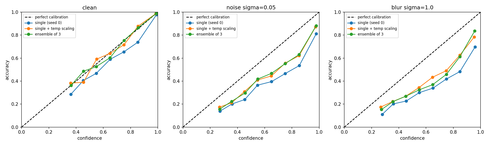

# CIFAR-10 Uncertainty Benchmark

Comparing ways to make an image classifier's confidence more trustworthy:
deep ensembles, MC dropout, temperature scaling, and test-time augmentation
(TTA). The question: which cheap method gives the most honest confidence,
and does it hold up when the data changes?

## Motivation
Classifiers often report high confidence even when they are wrong
(overconfident). In high-stakes settings, a model should know when it is
unsure. This project measures that with calibration metrics and compares
simple, practical methods and their compute cost.

## Setup
- Dataset: CIFAR-10 (50,000 train / 10,000 test images, 10 classes)
- Model: small CNN (3 conv blocks with BatchNorm, ReLU, MaxPool, then dropout and a linear layer), 1,187,274 parameters
- Framework: PyTorch, trained on a free Colab T4 GPU
- Training: SGD with momentum, OneCycle learning rate, 15 epochs, random crop and horizontal flip augmentation
- Seeds: 0, 1, 2

## Metrics
- Accuracy: fraction of test images classified correctly.
- Average confidence: mean of the model's top predicted probability.
- ECE (Expected Calibration Error): gap between confidence and accuracy, averaged over 15 confidence bins. Lower is better.
- NLL (negative log-likelihood): penalises confident wrong predictions. Lower is better.

## Status
- [x] Baseline CNN
- [x] Baseline calibration (ECE, NLL, average confidence)
- [x] Deep ensemble (3 seeds)
- [x] MC dropout
- [x] Temperature scaling
- [x] Test-time augmentation
- [x] Distribution shift (Gaussian noise, Gaussian blur)
- [x] Reliability diagrams
  
- [ ] Out-of-distribution data (SVHN)

## Results on clean CIFAR-10 (same 5,000 test images, mean of 3 seeds)
Temperature scaling was fitted on the other 5,000 test images.

| Method | Accuracy | Avg confidence | ECE | NLL | Cost |
|---|---|---|---|---|---|
| Single CNN | 90.6% | 93.1% | 0.026 | 0.290 | 1x |
| + temperature scaling | 90.6% | 90.4% | 0.008 | 0.277 | ~1x |
| + MC dropout (20 passes) | 90.7% | 92.3% | 0.019 | 0.286 | ~1x training |
| + TTA, 2 views (mirror) | 91.0% | 92.2% | 0.013 | 0.266 | 2x inference |
| + TTA, 10 mild views | 91.4% | 91.5% | 0.008 | 0.252 | 10x inference |
| Deep ensemble (3 seeds) | 91.6% | 91.8% | 0.011 | 0.247 | 3x training and inference |
| Ensemble + temperature scaling | 91.6% | 91.0% | 0.010 | 0.246 | 3x |

Findings on clean data:
- Temperature scaling alone reduced ECE from about 0.026 to 0.008 across all three seeds, at essentially no cost.
- TTA with 10 mild views (shifts of up to 2 pixels plus mirrors) came within 0.2 points of the ensemble's accuracy and matched temperature scaling's ECE, with no extra training, at 10x inference cost.
- The ensemble gave the best NLL and highest accuracy, at 3x compute.
- MC dropout gave a smaller calibration gain; dropout is applied only before the final layer, which likely limits its effect.
- A first TTA variant with larger shifts (up to 4 pixels) and mismatched padding hurt: accuracy fell to about 89% and the model became underconfident (checked on seeds 0 and 1 only). TTA views should match the augmentations used in training.

## Distribution shift (same 5,000 images, mean of 3 seeds, ECE; lower is better)
Gaussian noise and blur were applied to the test images. Temperatures were fitted once on clean data and reused.

| Condition | Accuracy (single) | Single | + temp | MC dropout | TTA 2 | Ensemble | Ensemble + temp |
|---|---|---|---|---|---|---|---|
| Clean | 90.6% | 0.026 | 0.008 | 0.019 | 0.013 | 0.011 | 0.010 |
| Noise 0.05 | 62.8% | 0.198 | 0.146 | 0.186 | 0.170 | 0.140 | 0.125 |
| Noise 0.10 | 29.9% | 0.453 | 0.385 | 0.438 | 0.430 | 0.390 | 0.369 |
| Noise 0.20 | 15.8% | 0.512 | 0.428 | 0.500 | 0.490 | 0.452 | 0.427 |
| Blur 0.7 | 71.1% | 0.101 | 0.043 | 0.091 | 0.077 | 0.054 | 0.038 |
| Blur 1.0 | 41.7% | 0.270 | 0.189 | 0.259 | 0.250 | 0.213 | 0.190 |
| Blur 1.5 | 29.0% | 0.336 | 0.250 | 0.325 | 0.324 | 0.282 | 0.258 |

Findings under shift:
- Accuracy falls sharply because the model was trained on clean images only.
- Confidence falls far less than accuracy, so every method becomes badly overconfident (for example, about 75% confidence at 30% accuracy under noise 0.1).
- Temperature scaling fitted on clean data still reduces ECE (roughly 15% to 55%), but does not fix the problem.
- At heavy shift, a single model with temperature scaling is about as well calibrated as the 3-model ensemble; the ensemble does not clearly justify its 3x cost for calibration.
- Calibration fixes cannot rescue a model whose accuracy has collapsed. Robustness training (for example noise augmentation) is the natural follow-up.

## Notebooks
- `01_baseline_cnn.ipynb`: data pipeline, model, training, baseline calibration
- `02_ensemble.ipynb`: 3-seed ensemble, MC dropout, temperature scaling
- `03_tta_and_shift.ipynb`: test-time augmentation and distribution shift experiments

## Run it
1. Open a notebook in Google Colab.
2. Set Runtime to a GPU (T4).
3. Run all cells top to bottom. The first run downloads CIFAR-10 (~170 MB).

## Limitations
- Only three seeds, so no formal confidence intervals.
- Temperature scaling was fitted on half of the test set rather than a separate validation set; all methods are reported on the other half.
- The mild-shift TTA variant was designed after the first variant underperformed and was evaluated on the same half, so its result involves some selection.
- ECE differences of a few thousandths are within noise at 5,000 images.
- Corruptions are synthetic (one noise realisation per level), not the standard CIFAR-10-C benchmark, and out-of-distribution data (SVHN) is not tested.
- Small CNN, not a state-of-the-art architecture.
